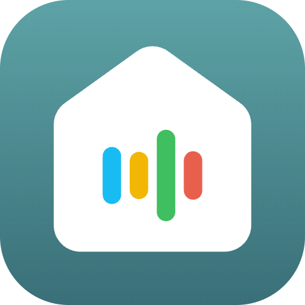

# Home Assistant Add-on: Kiosk Satellite Proxy

  

![Supports aarch64 Architecture][aarch64-shield] ![Supports amd64 Architecture][amd64-shield] ![Supports armhf Architecture][armhf-shield] ![Supports armv7 Architecture][armv7-shield] ![Supports i386 Architecture][i386-shield]

[Kiosk Satellite](https://kiosksatellite.com/) turns an Android device into a
dedicated Home Assistant kiosk. This add-on places its Remote Administration
web interface in the Home Assistant sidebar through ingress.

Browser requests enter through Home Assistant ingress and are forwarded by the
add-on to the kiosk Remote Administration server. This includes the web UI,
REST API requests, and the WebSocket used for live state and log updates.

It does not install or run Kiosk Satellite. Remote Administration must already
be enabled on the target device and must be reachable from Home Assistant.

See [the add-on documentation](DOCS.md) for configuration instructions and the
official [Remote Management API documentation](https://kiosksatellite.com/docs/remote-api/)
for details about the service on the kiosk.

This is an independent community add-on and is not affiliated with or endorsed
by Kiosk Satellite. The Kiosk Satellite logo is used unmodified from the
official project and remains subject to the
[Kiosk Satellite license](https://github.com/jxlarrea/kiosk-satellite/blob/main/LICENSE).

[aarch64-shield]: https://img.shields.io/badge/aarch64-yes-green.svg
[amd64-shield]: https://img.shields.io/badge/amd64-yes-green.svg
[armhf-shield]: https://img.shields.io/badge/armhf-yes-green.svg
[armv7-shield]: https://img.shields.io/badge/armv7-yes-green.svg
[i386-shield]: https://img.shields.io/badge/i386-yes-green.svg
